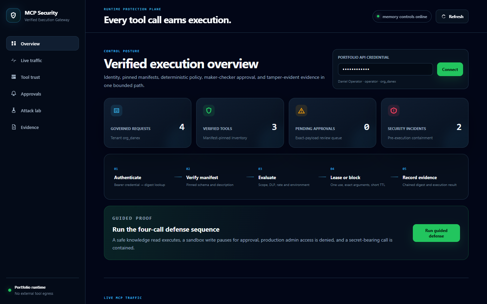
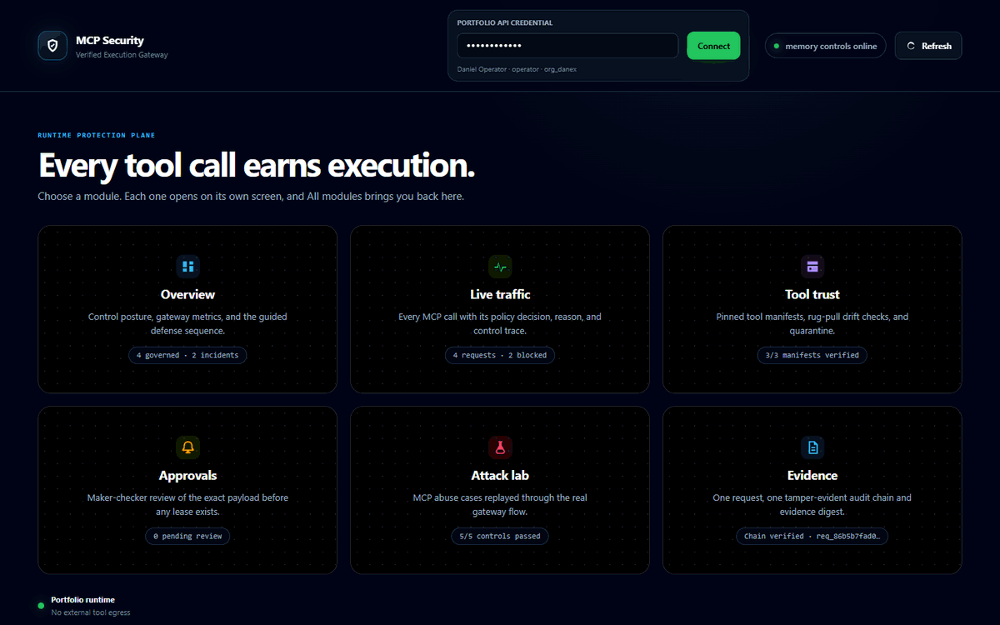
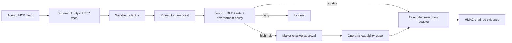
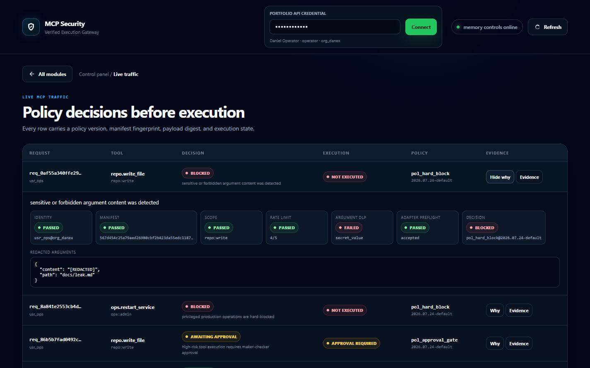
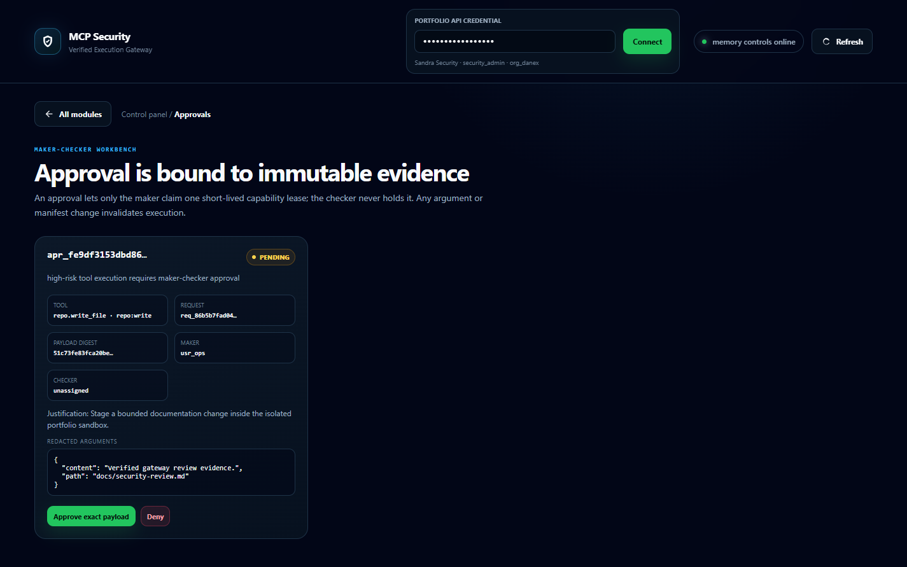
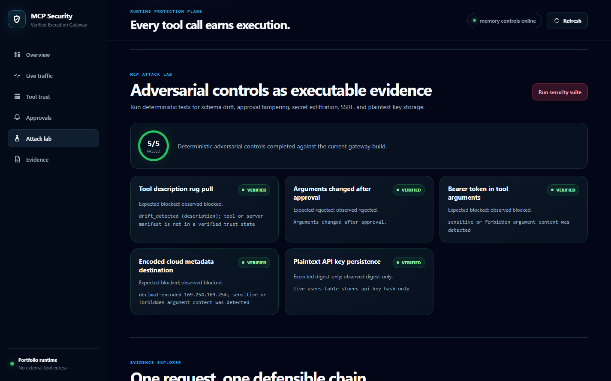
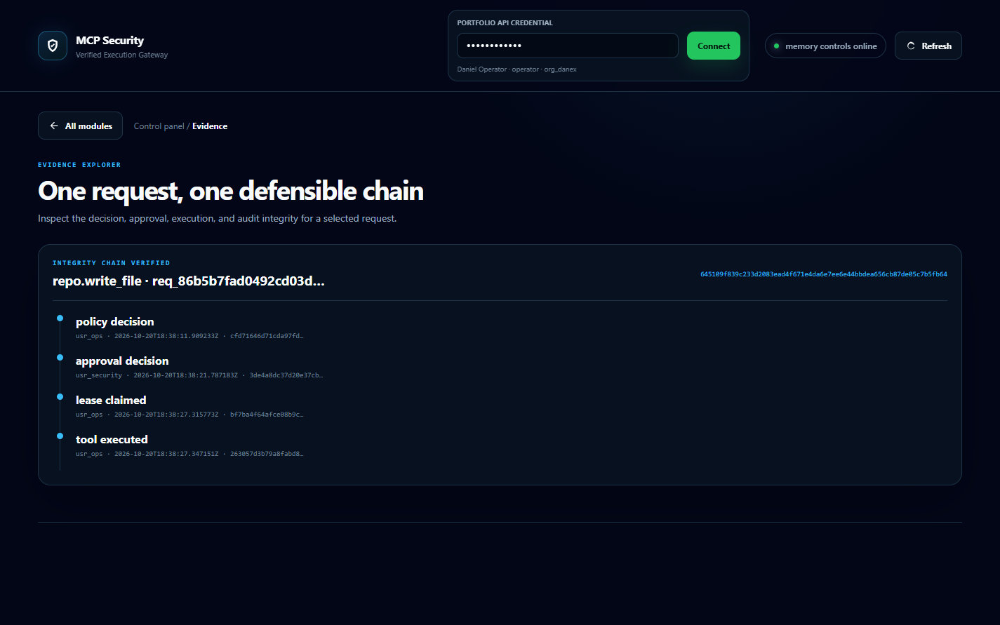

# MCP Security Gateway

> Protocol-aware runtime firewall for verified MCP tool execution.

[](https://github.com/danieloza/mcp-security-gateway/actions/workflows/ci.yml)
[](https://github.com/danieloza/mcp-security-gateway/releases/tag/v0.3.0)


[](LICENSE)

[Overview](#what-it-solves) · [Product Demo](#product-demo) · [Product Tour](#product-tour) · [Verified Execution](#verified-execution-flow) · [Connect a Client](#connect-your-client) · [API](docs/API_EXAMPLES.md) · [Threat Model](docs/THREAT_MODEL.md) · [Patch Notes](CHANGELOG.md) · [MIT License](LICENSE)



## What It Solves

Agents can discover powerful MCP tools, but discovery is not authorization. A
production control point must determine:

- which workload and tenant initiated the call;
- whether the server, tool description, and JSON schema still match an approved
  manifest;
- whether the requested scope and arguments fit policy;
- whether secrets or forbidden destinations appear in the call;
- whether a human must approve the exact payload;
- whether the approved call was modified, replayed, or executed twice;
- what evidence proves the final outcome.

MCP Security Gateway places that control point between an MCP client and a fixed
tool execution adapter. It supports protocol-level `initialize`, `ping`,
`tools/list`, and `tools/call`, then applies deterministic controls before any
side effect.

## Product Demo

This walkthrough is generated from the running gateway, not from mocked
screens. It follows one governed request across policy evaluation,
maker-checker approval, adversarial security tests, execution, and evidence.



| Stage | Control | Observable proof |
| --- | --- | --- |
| Request | Scope, environment, DLP, rate, and adapter policy | `executed`, `awaiting approval`, or `blocked` before side effects, with the reason and per-control trace |
| Approval | Maker-checker separation | Tool, justification, redacted payload, and digest shown to the checker |
| Attack testing | MCP abuse cases replayed through the gateway | Rug pull, tampering, secret egress, encoded SSRF, and key-storage checks |
| Execution | One-time capability lease claimed by the maker | Caller, manifest, arguments, policy, and expiry re-verified |
| Evidence | HMAC-linked audit events | Policy, approval, lease claim, and execution chain with integrity status |

The operator-led version takes about 90 seconds. See the
[presenter script](docs/DEMO_GUIDE.md) for the exact credential switches and
talk track.

## Verified Execution Flow



Every governed request records:

- random, non-enumerable identifiers;
- tenant, workload, server, tool, scope, and policy version;
- SHA-256 argument, manifest, and governed-request digests;
- a redacted argument representation;
- the policy trace and decision reason;
- approval actor, lease expiry, execution result digest, and audit-chain events.

## Security Capabilities

### API key hygiene

- raw credentials are accepted only at the request boundary;
- SQLite stores SHA-256 digests, never recoverable API-key values;
- legacy plaintext demo rows are migrated to digest-only storage;
- API responses never expose credential material;
- Redis rate-limit keys use an opaque subject digest rather than the credential;
- production mode refuses an in-memory rate-limit fallback.

The values in [Demo credentials](#demo-credentials) are intentionally public
portfolio credentials, not secrets. They exist only to make the local walkthrough
repeatable.

### Tool Manifest Trust

Tool names, descriptions, JSON schemas, required scopes, risk levels, and
annotations are fingerprinted. Candidate changes produce a field-level diff.
Security administrators can quarantine a drifted tool; a platform administrator
must explicitly restore its trust state.

MCP tool annotations are retained for interoperability and operator context, but
the gateway does not treat server-provided hints as authorization.

### Approval-bound capability leases

High-risk calls are held before execution. Approval itself hands out no
credential: the checker authorizes, and only the requesting workload can then
claim a random, short-lived, one-use lease bound to:

- tenant and requesting workload;
- server, tool, scope, and policy version;
- approved manifest digest;
- exact argument digest;
- complete governed-request digest.

Changing the path, payload, tool schema, caller, or policy context invalidates
execution. Reusing or re-claiming the lease is rejected. Neither the checker nor
a platform administrator can claim or execute another workload's lease.

### MCP Attack Lab

The operator console replays each attack through the real gateway flow —
submission, policy, approval, lease claim, and execution — on an isolated,
freshly seeded replica, so the live tenant's traffic and incidents stay
untouched:

- tool-description rug pull followed by a call to the drifted tool;
- argument substitution after approval and lease claim;
- secret-bearing tool arguments;
- a decimal-encoded cloud-metadata SSRF destination;
- plaintext API-key persistence (checked against the live schema).

A probe that crashes is reported as a failed control, and the test suite proves
the lab fails when argument DLP or execution binding is disabled.

## Operator Console

The dashboard provides:

- live MCP policy and execution traffic, with the decision reason on every row
  and an expandable trace of each policy control;
- tool trust registry with manifest fingerprints;
- maker-checker approval workbench that shows the tool, justification, and
  redacted payload being approved;
- maker-only lease claim and execution without browser persistence;
- attack-lab results;
- request evidence timeline and chain-integrity status;
- a four-call guided defense sequence for portfolio presentations.

The UI keeps the entered credential only in JavaScript memory. It does not use
cookies or browser storage. Tool arguments and justifications are
attacker-controlled, so the console renders them as text only; a test guards the
shipped script against HTML sinks such as `innerHTML`.

## Product Tour

The screenshots below use a clean local database and the same API paths covered
by the automated tests.

### 1. Policy enforcement before execution



One table separates policy decision from execution state. Safe knowledge access
executes, a regulated write pauses, and forbidden production or secret-bearing
calls are contained. Every row states its reason; the expanded trace shows
argument DLP failing on a secret while the stored arguments stay redacted.

### 2. Maker-checker approval bound to the payload



The reviewer sees the tool, justification, redacted payload, payload digest,
maker, and checker. Approval lets only the maker claim a short-lived capability
lease for that immutable payload.

### 3. Adversarial controls as executable evidence



The Attack Lab replays manifest rug pulls, post-approval argument tampering,
secret exfiltration, and a decimal-encoded cloud-metadata SSRF destination
through the real gateway flow on an isolated replica, and checks digest-only
API-key storage. Each card shows the gateway's own rejection.

### 4. Tamper-evident evidence chain



The evidence explorer links the policy decision, the checker's approval, the
maker's lease claim, and the execution, and verifies the organization audit
chain before presenting the evidence-pack digest.

## API Surface

### MCP protocol boundary

- `POST /mcp` — `initialize`, `ping`, `tools/list`, `tools/call`, and
  `notifications/*` (see [Connect Your Client](#connect-your-client))

### Operator API

- `GET /health`
- `GET /me`
- `GET /mcp-servers`
- `GET /policies`
- `GET /tool-registry`
- `POST /tool-registry/{tool_id}/verify`
- `POST /tool-registry/{tool_id}/restore`
- `GET /requests`
- `GET /requests/{request_id}`
- `POST /requests`
- `GET /approvals`
- `POST /approvals/{approval_id}/decision`
- `POST /requests/{request_id}/lease`
- `POST /requests/{request_id}/execute`
- `GET /requests/{request_id}/evidence`
- `GET /incidents`
- `POST /attack-lab/run`

See [API examples](docs/API_EXAMPLES.md) for protocol and approval flows.

## Run Locally

```powershell
git clone https://github.com/danieloza/mcp-security-gateway.git
cd mcp-security-gateway

python -m venv .venv
.\.venv\Scripts\Activate.ps1
python -m pip install -e ".[dev]"
python -m uvicorn mcp_security_gateway.main:app --reload --host 127.0.0.1 --port 8000
```

Open:

- operator console: `http://127.0.0.1:8000/dashboard`
- local API documentation: `http://127.0.0.1:8000/docs`

Interactive API documentation is disabled automatically when
`MSG_ENVIRONMENT=production`.

## Demo Credentials

These credentials are public, local-only portfolio fixtures:

```text
operator:       msg-ops-demo
security admin: msg-security-demo
platform admin: msg-platform-demo
```

Use the preferred header:

```http
Authorization: Bearer msg-ops-demo
```

`X-API-Key` remains available for backward-compatible local examples, but new
integrations should use the Bearer transport. Real deployments must replace
these fixtures with workload identity or an organizational authorization
service.

## Connect Your Client

Point any MCP client that supports the Streamable HTTP transport and custom
headers at `http://127.0.0.1:8000/mcp` with a Bearer credential. The agent then
sees every governance decision as a normal tool result:

| Gateway decision | `structuredContent.status` | `isError` |
| --- | --- | --- |
| verified low-risk call | `executed` | `false` |
| high-risk call held for maker-checker | `approval_required` | `false` |
| policy violation (secret, scope, traversal, production admin) | `denied` | `true` |

### Claude Code

```bash
claude mcp add --transport http mcp-security-gateway http://127.0.0.1:8000/mcp \
  --header "Authorization: Bearer msg-ops-demo"
```

### Cursor (`.cursor/mcp.json`)

```json
{
  "mcpServers": {
    "mcp-security-gateway": {
      "url": "http://127.0.0.1:8000/mcp",
      "headers": { "Authorization": "Bearer msg-ops-demo" }
    }
  }
}
```

### VS Code (`.vscode/mcp.json`)

```json
{
  "servers": {
    "mcp-security-gateway": {
      "type": "http",
      "url": "http://127.0.0.1:8000/mcp",
      "headers": { "Authorization": "Bearer msg-ops-demo" }
    }
  }
}
```

### MCP Python SDK

```python
import asyncio

from mcp import ClientSession
from mcp.client.streamable_http import create_mcp_http_client, streamable_http_client


async def main() -> None:
    http = create_mcp_http_client(headers={"Authorization": "Bearer msg-ops-demo"})
    async with http, streamable_http_client("http://127.0.0.1:8000/mcp", http_client=http) as streams:
        async with ClientSession(streams[0], streams[1]) as session:
            await session.initialize()
            result = await session.call_tool("kb.search", {"query": "manifest quarantine"})
            print(result.structured_content["status"])


asyncio.run(main())
```

### Protocol contract

- negotiates MCP `2025-11-25` or `2025-06-18`; a client offering any other
  revision is answered with `2025-11-25`, the latest supported one;
- `2025-03-26` is not offered because it requires JSON-RPC batch support;
- notifications such as `notifications/initialized` return `202 Accepted`
  with no body;
- requests without an `id`, or with a `null` id, are rejected with `400`;
- an `MCP-Protocol-Version` header, when sent, must name a supported revision;
- capabilities advertise `tools.listChanged: false`, because there is no
  server-to-client stream (`GET /mcp` returns `405`).

Verification boundary: the official MCP Python SDK 2.3.0 client completed
`initialize`, `notifications/initialized`, `tools/list`, governed `tools/call`
outcomes, and `ping` against this gateway, negotiating down from its own
`2026-07-28` revision. The Claude Code, Cursor, and VS Code snippets follow each
client's documented remote HTTP format and were not individually exercised.

Authentication is a static Bearer credential. The gateway does not publish
OAuth 2.1 protected-resource metadata, so clients that only connect to remote
servers through OAuth discovery cannot use it yet.

## Guided Demo

1. Open the operator console.
2. Connect as `msg-ops-demo`.
3. Run **Guided defense**:
   - `kb.search` is verified and executed;
   - `repo.write_file` is held for approval;
   - `ops.restart_service` is hard-blocked;
   - a Bearer-like value inside arguments is redacted and contained.
4. Switch to `msg-security-demo`.
5. Approve the exact sandbox-write payload and run the Attack Lab.
6. Switch back to `msg-ops-demo`.
7. Select **Claim & execute**: only the maker can claim the one-time lease, and
   the console spends it immediately; then open the evidence timeline.
8. In Tool Trust, simulate a changed tool description and show the manifest
   drift result.

The full presenter script is in [docs/DEMO_GUIDE.md](docs/DEMO_GUIDE.md).

## Docker Compose

```powershell
docker compose config --quiet
docker compose up --build
```

Compose binds the API to loopback, keeps Redis on the internal network, drops
Linux capabilities, uses a non-root application user, and mounts only the
persistent SQLite data volume. The local fallback audit key remains a
development convenience; configure a managed secret for any non-local runtime.

## Testing

```powershell
python -m pip install -e ".[dev]"
python -m pytest -q
python -m pip_audit .
docker compose config --quiet
```

The suite covers key migration, credential response shaping, MCP version
negotiation, notification handling, a full client handshake,
verified low-risk execution, maker-checker separation, maker-only lease claims,
platform-admin execution separation, argument-bound leases, lease replay,
attack-lab replicas that fail when controls are disabled, manifest quarantine, DLP blocking, sandbox-path rejection before
approval, audited execution failures, encoded-IPv4 SSRF destinations, tenant
isolation, Origin validation, strict request schemas, evidence integrity,
single-source versioning, dashboard headers, and the absence of HTML sinks in
the dashboard script.

## Production-shaped, Not Production-ready

This repository proves the security control path. It intentionally does not
claim to be a drop-in enterprise gateway.

Current portfolio boundaries:

- SQLite persistence rather than managed PostgreSQL and migrations;
- public local demo credentials rather than corporate workload identity;
- a fixed in-process execution adapter rather than arbitrary remote MCP server
  registration;
- no unrestricted outbound HTTP, filesystem, shell, or production operations;
- local HMAC evidence integrity without external timestamping or immutable
  archival;
- single-node operator workflow without organizational incident ownership.

A company rollout would add OAuth 2.1 resource-server validation, managed secrets
and key rotation, PostgreSQL, durable queues, network egress policy, a controlled
server onboarding process, signed manifest releases, centralized telemetry,
backups, incident response, and independent audit retention.

See [Threat Model](docs/THREAT_MODEL.md) and
[Architecture](docs/ARCHITECTURE.md).

## Proof Assets

- animated product demo: [docs/assets/mcp-security-gateway-demo.gif](docs/assets/mcp-security-gateway-demo.gif)
- operator dashboard: [docs/assets/gateway-dashboard.png](docs/assets/gateway-dashboard.png)
- policy enforcement: [docs/assets/policy-enforcement.png](docs/assets/policy-enforcement.png)
- maker-checker approval: [docs/assets/approval-workbench.png](docs/assets/approval-workbench.png)
- Attack Lab: [docs/assets/attack-lab.png](docs/assets/attack-lab.png)
- evidence chain: [docs/assets/evidence-chain.png](docs/assets/evidence-chain.png)
- architecture: [docs/ARCHITECTURE.md](docs/ARCHITECTURE.md)
- threat model: [docs/THREAT_MODEL.md](docs/THREAT_MODEL.md)
- API examples: [docs/API_EXAMPLES.md](docs/API_EXAMPLES.md)
- guided demo: [docs/DEMO_GUIDE.md](docs/DEMO_GUIDE.md)
- case study: [docs/CASE_STUDY.md](docs/CASE_STUDY.md)
- patch notes: [CHANGELOG.md](CHANGELOG.md)

## Interview Framing

> I built a protocol-aware MCP enforcement point rather than trusting the agent
> or the tool server. Every call is tied to workload identity, a pinned tool
> manifest, versioned policy, and an exact argument digest. Risky calls receive a
> one-time approval lease, while manifest drift, secret egress, scope escalation,
> and production operations are contained before execution.

## Related Project

[Regulated AI Agent Platform](https://github.com/danieloza/regulated-ai-agent-platform)
demonstrates broader governance lifecycles. MCP Security Gateway stays deliberately
narrow: it is the protocol-specific enforcement boundary for agent tool traffic.

## License

Copyright © 2026 Daniel Danek. Released under the
[MIT License](LICENSE).
