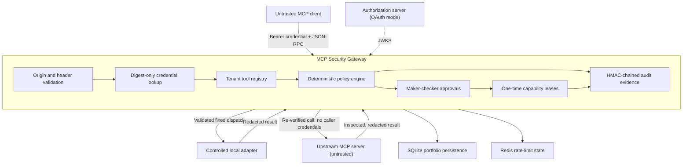

# Architecture

MCP Security Gateway is a protocol-aware enforcement point between an MCP client
and the tools it calls: a fixed, controlled execution adapter, or
operator-configured upstream MCP servers in proxy mode.

## Trust Boundaries

The client, tool arguments, MCP tool descriptions, annotations, and results are
untrusted. So are upstream servers: what they say about their tools, and what
their tools return. The gateway's pinned manifest registry and deterministic
policy are authoritative for the portfolio runtime.

## MCP Boundary

`POST /mcp` supports:

- `initialize`, negotiating MCP `2025-11-25` or `2025-06-18`;
- `ping`;
- `tools/list`;
- `tools/call`;
- `notifications/*`, acknowledged with `202 Accepted` and no body.

The gateway advertises `tools.listChanged: false` and answers `GET /mcp` with
`405`, because it keeps no server-to-client stream. `2025-03-26` is not offered,
since that revision requires JSON-RPC batch support.

The transport validates:

- `Authorization: Bearer` credentials: a demo key resolved by its digest, or
  an access token in OAuth mode;
- an allowlisted browser `Origin`, when present;
- consistency between `Mcp-Method` / `Mcp-Name` headers and the JSON-RPC body;
- a supported `MCP-Protocol-Version` header, when present;
- a string or integer request `id` (only notifications may omit it);
- strict Pydantic envelopes and a bounded Content-Length;
- tenant membership before exposing server or tool inventory.

This is a deliberately bounded MCP protocol surface, not a transparent generic
proxy. Upstream servers come only from operator configuration: an agent can
never add or address one, and arbitrary target URLs are not supported.

## Authentication Modes

`MSG_AUTH_MODE` selects one of two modes:

- **`static`, the default.** Callers present the public demo keys, resolved by
  their SHA-256 digest. Production mode refuses to start in this mode.
- **`oauth`.** The gateway is an OAuth 2.1 resource server, as MCP 2025-11-25
  authorization describes it:
  - **Metadata.** It publishes RFC 9728 protected-resource metadata at the
    path-inserted URI `/.well-known/oauth-protected-resource/mcp`.
  - **Challenges.** A missing or invalid token gets a `401` whose
    `WWW-Authenticate` header points to that metadata. A missing scope gets
    `403 insufficient_scope`.
  - **Token checks.** Keys come from the authorization server's JWKS. Only
    asymmetric algorithms are accepted, and the header's algorithm is checked
    against the allowlist before any key lookup. `iss`, `exp`, `nbf` and `sub`
    are checked with 30 seconds of leeway, and `aud` must contain the
    gateway's resource URI (RFC 8707).
  - **Scopes.** `mcp:tools` covers `/mcp`, and `gateway:console` covers the
    operator API.
  - **Users.** Each `sub` maps explicitly to a gateway user. An unknown
    subject is refused, never created.
  - **Unavailable keys.** If the JWKS cannot be fetched, the answer is `503`,
    not `401`.

The token goes no further than authentication. Execution sees only the mapped
user, and nothing forwards the token.

## Upstream Proxy

`MSG_UPSTREAMS` names a JSON list of upstream MCP servers that speak Streamable
HTTP. Each one is registered as a server of its tenant. None of its tools is
listed until a security or platform administrator syncs it.

- **Sync.** A sync pins each new tool under `<prefix>.<name>`: its name,
  description, input schema and annotations. A definition that already matches
  an injection pattern is quarantined instead ("tool poisoning").
- **The call.** At the start of each call, the gateway reads the upstream's
  current definition and compares it with the pin. A difference quarantines
  the tool, opens a critical incident and denies the call.
- **Just before forwarding.** The comparison runs again after any approval and
  lease claim. This closes the window between approval and execution.
- **Forwarding.** A small client of the gateway's own, built on `httpx`, sends
  `initialize`, `notifications/initialized`, `tools/list` (to read the current
  definitions) and `tools/call`. It follows no
  redirects, caps answers at 1 MiB, times out after 10 seconds, and reads JSON
  or SSE. It sends only the protocol headers, so the caller's credentials
  never leave the gateway.
- **Output.** The result is checked for instruction-like content before it
  reaches the agent. A match withholds it: the agent gets `response_blocked`
  with the finding types and a digest, and the gateway records an incident and
  a `tool_output_withheld` audit event. The request's execution status is
  `output_withheld`, not `executed`. Clean output is redacted like the
  built-in tools' output.
- **Failure.** An unreachable upstream fails closed.

## Decision Pipeline

1. Resolve the caller from the SHA-256 credential digest, or from a verified
   access token in OAuth mode.
2. Bind the organization and actor to the request.
3. Load the registered server and pinned tool manifest. For an upstream tool,
   compare the definition the upstream serves now with the pin.
4. Validate arguments against the stored JSON schema.
5. Apply fixed-window caller rate limits.
6. Detect secret-bearing values and forbidden network destinations.
7. Ask the execution adapter to preflight the arguments, so a call it would
   refuse (for example a sandbox path traversal) is blocked before approval.
8. Verify requested scope, server environment, and manifest trust state.
9. Select a versioned policy:
   - `pol_default_allow`;
   - `pol_approval_gate`;
   - `pol_hard_block`.
10. Persist the redacted arguments, digests, policy trace, and decision.
11. Execute, hold for approval, or create an incident.

For an upstream tool, execution re-checks the definition once more, forwards
the call, and inspects the output before it reaches the agent.

If the adapter still fails after a lease is consumed, the gateway records a
`failed` execution and a `tool_execution_failed` audit event, and the request
cannot be retried with the spent lease.

## Approval and Execution Binding

A high-risk decision stores:

- SHA-256 argument digest;
- manifest digest;
- policy version;
- governed-request digest;
- maker identity.

The checker cannot be the maker. Approval marks the request `lease_ready` but
returns no credential. The maker then claims a random token through
`POST /requests/{request_id}/lease`; only its digest is persisted. The
capability lease is:

- claimable once, and only by the requesting workload;
- executable only by the requesting workload, with no platform-administrator
  override;
- valid for a short configured TTL that starts at the claim;
- usable once;
- tenant and request bound;
- consumed atomically;
- rejected before consumption when the caller, arguments, manifest, or governed
  request digest differs.

The local execution adapter exposes two demonstrable behaviors:

- `kb.search` returns bounded internal knowledge results;
- `repo.write_file` stages metadata for an isolated portfolio sandbox without
  writing to the host filesystem.

`ops.restart_service` intentionally has no execution adapter and is hard-blocked.

## Evidence Integrity

Each audit event contains:

- organization, event type, subject, and actor;
- canonical redacted payload JSON;
- previous event digest;
- event HMAC digest;
- UTC timestamp.

Appending uses an immediate SQLite transaction so parallel events cannot select
the same chain head. Evidence export verifies the full organization chain before
returning the request-specific timeline and evidence-pack digest.

The HMAC key is a local development default unless configured. A production
design must load it from managed key storage, rotate it deliberately, and anchor
or archive evidence outside the primary database.

## Runtime Security Defaults

- Trusted Host validation;
- no CORS middleware by default;
- CSP, clickjacking, MIME-sniffing, referrer, and permissions headers;
- interactive API docs disabled in production mode;
- non-root container user;
- dropped Linux capabilities and no-new-privileges in Compose;
- Redis required in production;
- OAuth mode required in production;
- raw API credentials absent from database rows, API responses, and rate-limit
  keys.

## Scaling Boundary

SQLite, the local execution adapter, and an in-process upstream client are
appropriate for a deterministic portfolio walkthrough. Multi-replica operation
would require PostgreSQL, durable migrations, managed Redis, a queue or worker
boundary, distributed tracing, and an upstream connector service with its own
egress policy.
