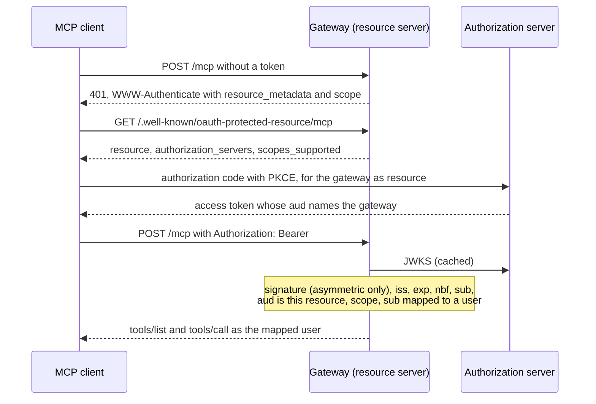

# OAuth Resource-Server Mode

This is the detailed reference. The [README](../README.md#oauth-resource-server-mode)
has the summary.

With `MSG_AUTH_MODE=oauth`, the gateway is an OAuth 2.1 resource server as the
MCP 2025-11-25 authorization specification describes it:

- **It validates tokens. It does not issue them.** The tokens come from an
  external authorization server.
- **It publishes RFC 9728 protected-resource metadata** at
  `/.well-known/oauth-protected-resource/mcp`. This is the path-inserted URI
  for a resource at `<origin>/mcp`.
- **A missing or invalid token is a `401`.** The response carries
  `WWW-Authenticate: Bearer` with `resource_metadata` and `scope`, and
  `error="invalid_token"` when a token was sent.
- **A token without the needed scope is a `403`** with
  `error="insufficient_scope"`. The scope is `mcp:tools` for `/mcp` and
  `gateway:console` for the operator API.
- **Tokens are checked against the authorization server's JWKS:**
  - the signature, with asymmetric algorithms only, so `none` and HS256 are
    refused;
  - `iss`, `exp`, `nbf` and `sub`;
  - **`aud`, which must contain the gateway's resource URI** (RFC 8707). A
    token minted for another resource is refused.
- **A token's `sub` must be mapped explicitly to a gateway user.** An unknown
  subject is refused, never created.
- **The token goes no further than authentication.** Tool execution sees only
  the mapped user, so a client's token is never passed through.
- **The static demo keys and `X-API-Key` are not accepted** in this mode.
- **Production refuses to start in static mode.**

## The flow



The gateway never sees the client's authorization request and never forwards the
token. The local Keycloak realm below also issues scripted tokens with the
password grant, for testing only.

## Configuration

Production mode (`MSG_ENVIRONMENT=production`) refuses to start unless this
mode is on. The guard keys off that variable alone, so run every shared or
staging deployment with it as well.

| Variable | Example (local Keycloak realm) |
| --- | --- |
| `MSG_AUTH_MODE` | `oauth` |
| `MSG_OAUTH_RESOURCE` | `http://127.0.0.1:8000/mcp` |
| `MSG_OAUTH_ISSUER` | `http://127.0.0.1:8081/realms/gateway` |
| `MSG_OAUTH_JWKS_URL` | `http://127.0.0.1:8081/realms/gateway/protocol/openid-connect/certs` |
| `MSG_OAUTH_SUBJECTS` | `5f6c1d2e-0a41-4f43-9a0b-6e1d7c2a9b01=usr_ops,8a3e4b7c-2d19-4c55-b1e2-3f9a0d6c4e02=usr_security` |
| `MSG_OAUTH_ALGORITHMS` | optional, default `RS256,ES256` |

## Try it with a local Keycloak

```powershell
docker compose --profile oauth up keycloak
# in another shell, with the variables above set:
python -m uvicorn mcp_security_gateway.main:app --host 127.0.0.1 --port 8000

$token = (Invoke-RestMethod -Method Post `
  -Uri http://127.0.0.1:8081/realms/gateway/protocol/openid-connect/token `
  -Body @{ grant_type = "password"; client_id = "gateway-demo-cli";
           username = "ops"; password = "ops-demo"; scope = "mcp:tools" }).access_token
Invoke-RestMethod -Method Post -Uri http://127.0.0.1:8000/mcp `
  -Headers @{ Authorization = "Bearer $token" } -ContentType "application/json" `
  -Body '{"jsonrpc":"2.0","id":1,"method":"tools/list"}'
```

**About the realm** (`deploy/keycloak/gateway-realm.json`):
- its users have fixed ids, so the subject map above stays stable;
- each scope carries an audience mapper that puts the resource URI in `aud`;
- its users, passwords and the password grant are public, local-only fixtures for
  scripted tokens. Interactive MCP clients use the authorization code flow with
  PKCE.

**As run on 2026-11-17** against Keycloak 26.4.5 with this realm, on a fresh
database:
- the metadata document and the 401 challenge were as described above;
- an `ops` token with `mcp:tools` got `tools/list`, `kb.search` → `executed` and
  `repo.write_file` → `approval_required`;
- the same token on the console API got `403 insufficient_scope`;
- with `gateway:console` tokens, the maker could not approve their own request
  (`403`), and `security` could;
- the static demo key got `401 invalid_token`.

**Claude Code 2.1.248**, pointed at the gateway in this mode without a header,
read the 401 challenge, fetched the metadata, found the Keycloak realm and tried
dynamic client registration. The realm's "Trusted Hosts" policy refused it: the
realm only issues scripted tokens. An interactive login from an MCP client
needs an authorization server that accepts its registration.

**Not part of this mode:**
- the gateway as an authorization server;
- dynamic client registration;
- token exchange;
- a console login.

## Tests

The tests in [`tests/test_oauth.py`](../tests/test_oauth.py) sign tokens with keys
generated during the test run, so they need no authorization server. They cover:
- the metadata document and the `401` and `403` challenges;
- each refused token:
  - a wrong audience, or none;
  - expired, or not yet valid;
  - a wrong issuer;
  - a bad signature, or an unknown key;
  - `alg: none`, or HS256 with the public key as its secret;
  - no subject, or an unknown one;
  - a static key, or `X-API-Key`;
- a missing scope;
- maker-checker separation with OAuth identities;
- unavailable signing keys (`503`);
- the production guard, and unsafe settings.

`python scripts/mutation_check.py oauth` removes each of nine OAuth checks in
turn and expects a failing test every time. CI runs it on every pull request.
